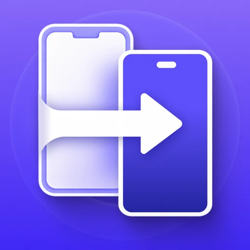
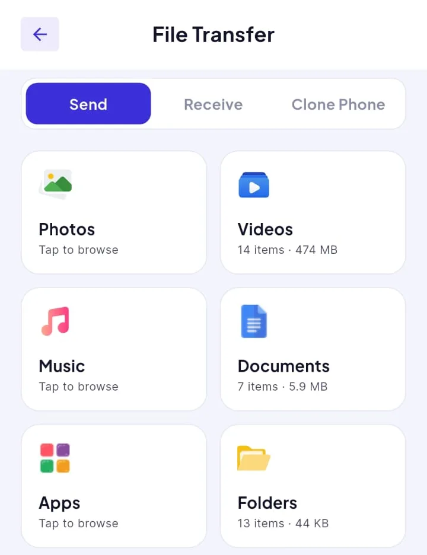
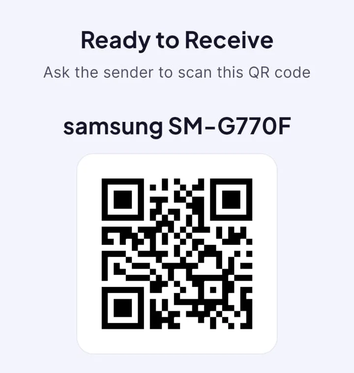
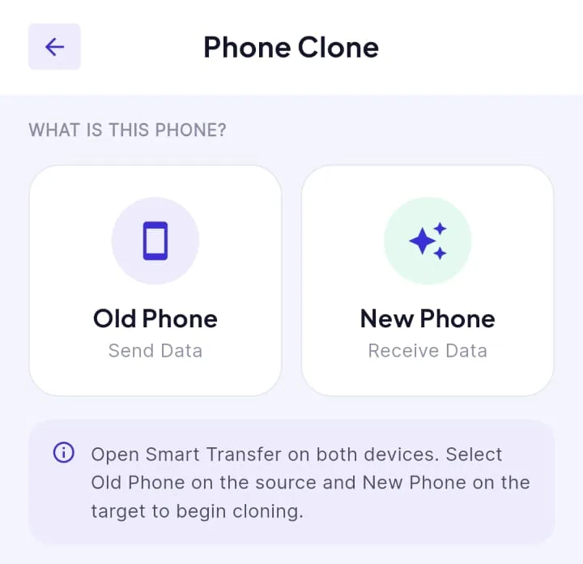
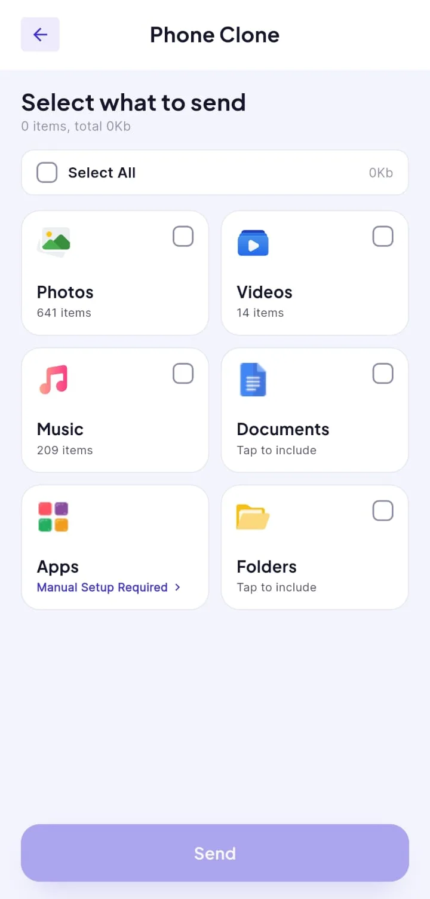
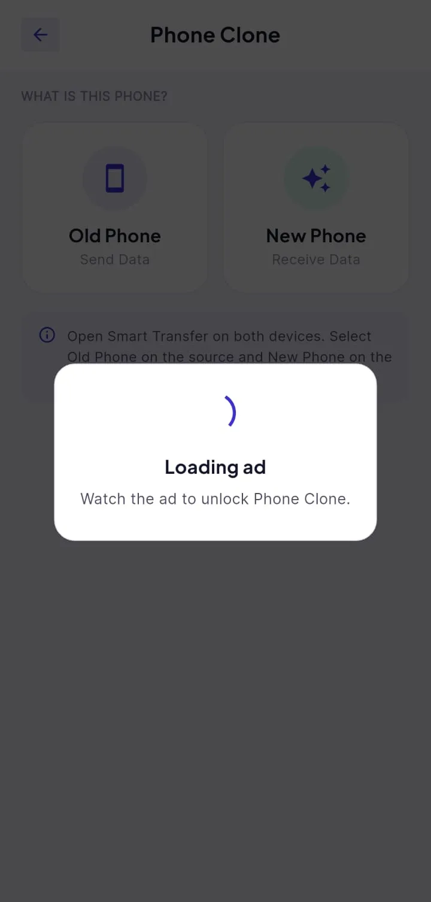
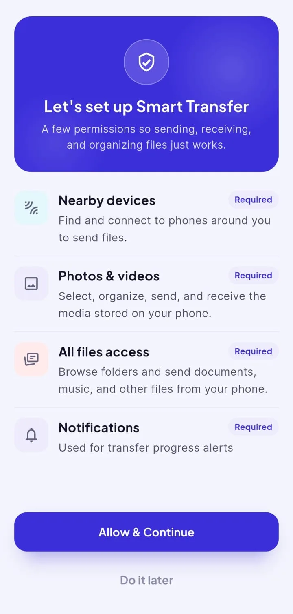
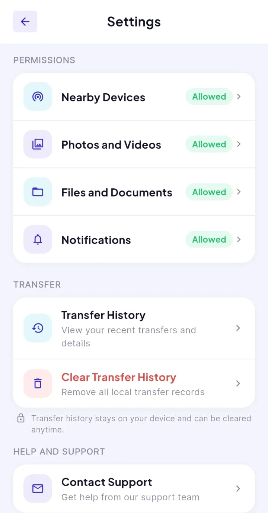
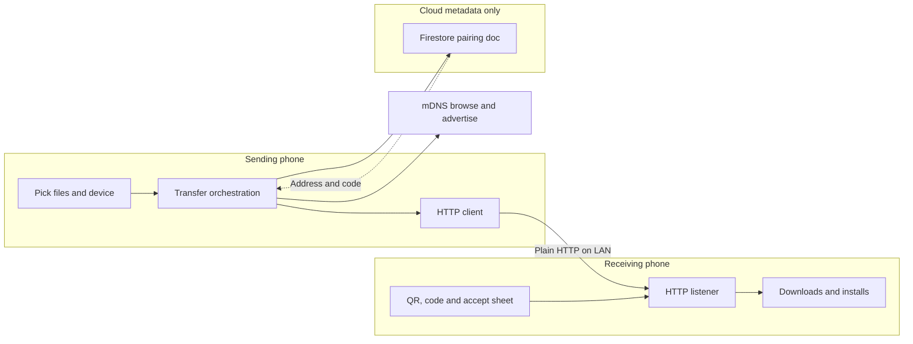

# Smart Transfer

**An Android phone-to-phone file mover: pick photos, videos, music, documents, apps or folders on one device, pair over the same Wi-Fi or hotspot through nearby discovery, a QR code or a short numeric code, then stream the payload directly to the other phone over plain HTTP on the local network. A Phone Clone path batches the same categories for a new-device setup.**

**Android (Google Play)** 
Flutter · Dart · Cloud Firestore (pairing metadata) · mDNS/NSD · HTTP file server on device

<table>
  <tr>
    <td align="center"></td>
    <td align="center"></td>
  </tr>
</table>
Real screenshots from the Android build, cropped to the app content (system status bar and ad-placeholder strips removed), captured with sample/placeholder data, metadata removed.

---

## Get the App

  

Smart Transfer is a utility for copying files between two phones you control. File bytes stay on the local network between the two devices; a cloud database holds pairing metadata only (device names, a short code, LAN address and session status), not the transferred files. This portfolio describes engineering behaviour only. It does not quote store marketing about speed, security or encryption, and it does not treat in-app premium copy as a performance guarantee.

## Product at a Glance

| | |
|---|---|
| **What it is** | Send selected content to another phone, receive with a QR or code, or run a multi-category Phone Clone from an old device to a new one |
| **Platform** | Android release on Google Play; the Flutter tree includes iOS-oriented permission branches but there is no iOS store listing in scope here |
| **Pairing** | Nearby list via LAN service discovery, QR scan, or six-digit code resolved through Firestore |
| **Transfer wire** | Lightweight HTTP server on the receiver; sender uploads in fixed-size chunks with flush timeouts, byte-offset resume, pause/resume/cancel side signals |
| **Categories** | Photos, videos, music, documents, user-installed apps (where the OS allows), and folder trees |
| **Clone flow** | Choose Old Phone vs New Phone, tick multiple categories (apps need per-app selection), then reuse the same pairing and transfer pipeline |
| **Permissions** | Camera (QR), nearby Wi-Fi devices (discovery), broad storage access for folders and documents, notifications for progress, install-unknown-apps for received APKs |
| **History** | Local list of past sends, receives and clones with detail screens; clear-all from Settings |
| **Monetisation** | Banner, native, interstitial, app-open and rewarded placements; Pro subscription hides ads; Phone Clone and some continued transfers can be gated behind a rewarded ad |
| **Languages** | Eleven in-app locales (Arabic, German, English, French, Hindi, Italian, Japanese, Korean, Portuguese, Russian, Chinese) |
| **Services** | Firebase (Firestore, Analytics, Crashlytics, Cloud Messaging), Google Play Billing, Google Mobile Ads, Play in-app updates |
| **Code size** | 129 Dart files and about 25.8k lines excluding bundled language tables (about 6.3k lines across twelve language files), plus one widget test |

## Product Showcase

<table>
  <tr>
    <td align="center"> <b>Clone role</b> Source vs target before picking content</td>
    <td align="center"> <b>Clone content</b> Multi-category batch with counts</td>
    <td align="center"> <b>Rewarded gate</b> Modal before clone proceeds</td>
    <td align="center"> <b>Setup</b> Required permissions explained</td>
    <td align="center"> <b>Settings</b> Permission status and local history</td>
  </tr>
</table>

## Key Features

- **Send tab.** Category grid opens dedicated pickers: gallery-backed photos and videos, audio library scan, document picker, installed-app list with split-APK awareness, and a folder browser that respects scoped-storage rules on modern Android.
- **Receive tab.** Starts a local listener, shows a QR encoding either a cloud session id or inline LAN coordinates, displays a six-digit code, and advertises the device on the LAN for the nearby list.
- **Choose device.** Sender can tap a discovered peer, scan the receiver QR, or type the numeric code; the UI walks through connecting sheets and an accept/decline step on the receiver.
- **Transferring UI.** Per-file progress, pause and resume on the sender, stall detection, partial-complete and failed screens with retry hooks, and a banner when the LAN link drops.
- **Phone Clone.** Same transfer engine with a multi-select content screen and Old/New role cards; apps are excluded from bulk select-all because each install must be chosen explicitly.
- **Received apps.** APK parts arrive under encoded filenames, are grouped by package, and can trigger the platform install flow when unknown-app installs are allowed.
- **Onboarding and coach marks.** Language chooser, marketing onboarding pages (described here only as UI, not as performance claims), and a home-screen tutorial overlay.
- **Pro.** Subscription purchase through Play Billing; premium flag stored locally and consulted by ad widgets.

## Engineering Highlights

### Pairing without moving bytes through the cloud
- **Problem.** Two phones on the same hotspot still need a reliable way to exchange IP and port when mDNS browse fails or the sender is not on the LAN yet.
- **Approach.** The receiver creates a Firestore document with a random six-digit code, device label, LAN address, port and status. The QR prefers a Firebase session token; it can fall back to embedding raw LAN fields when Firebase is unavailable. Nearby discovery runs in parallel via a private mDNS service type with TXT records for id, name, platform and optional IPv4 hints.
- **Outcome.** Senders resolve peers three ways; once connected, all file payloads use direct HTTP between devices. Closing a session deletes the cloud document.

### Chunked LAN uploads with resume and backpressure
- **Problem.** Large videos and folder trees must survive Wi-Fi flaps, user pauses and process death without restarting from zero.
- **Approach.** The receiver exposes an HTTP listener. The sender posts a file list for approval, then for each file asks how many bytes already exist, streams the remainder in 256 KiB chunks with per-chunk flush timeouts, and listens for pause, resume, cancel and status probes on separate control calls. The receiver runs a stall watchdog that respects sender-side pause.
- **Outcome.** Interrupted files can continue from the last acknowledged byte. A persisted pending batch on the sender offers reconnect within a six-hour window after a hard kill.

### Android permissions as part of the product
- **Problem.** Discovery, media reads, folder sends, APK installs and progress notifications each map to different Android permission models, including settings deep-links for nearby Wi-Fi and all-files access.
- **Approach.** A first-run screen explains four required rows; Settings mirrors live permission status with shortcuts to system toggles. Nearby Wi-Fi denial triggers a dialog that routes to app settings instead of silently empty lists.
- **Outcome.** Users see why each grant exists before transfer screens ask for content.

More depth: [docs/ENGINEERING_CHALLENGES.md](docs/ENGINEERING_CHALLENGES.md).

## Architecture

  

  

Details: [docs/ARCHITECTURE.md](docs/ARCHITECTURE.md).

## Technology Stack

| Layer | Technology |
|---|---|
| App | Flutter / Dart 3, imperative UI with feature folders |
| LAN | `nsd` for mDNS, Dart `HttpServer` / `HttpClient` for peer transfer |
| Pairing | Cloud Firestore documents, `qr_flutter` and `mobile_scanner` |
| Media and files | `photo_manager`, `file_picker`, custom gallery and folder services |
| Apps | Installed-app enumeration, encoded multi-part APK naming, platform install bridge |
| Background | `flutter_foreground_task` data-sync foreground service during active transfers |
| Local state | `shared_preferences` for history, pending batches, premium flag and locale |
| Backend | Firebase Analytics, Crashlytics, Cloud Messaging; Firestore for pairing metadata |
| Store and ads | Play Billing, Google Mobile Ads, Play in-app updates |
| Testing | One `flutter_test` widget test on the splash screen |

## Documentation

| Read | For |
|---|---|
| [Product overview](docs/PRODUCT_OVERVIEW.md) | Screens, flows and user-visible behaviour |
| [Technical case study](docs/TECHNICAL_CASE_STUDY.md) | End-to-end transfer and pairing mechanics |
| [Architecture](docs/ARCHITECTURE.md) | Layers, diagrams and integration boundaries |
| [Engineering challenges](docs/ENGINEERING_CHALLENGES.md) | Problem, approach and trade-offs |
| [Privacy and source](docs/PRIVACY_AND_SOURCE.md) | What is and is not published |

## Source Code

This repository is a portfolio showcase for a production application. Production source code is maintained privately. See [RIGHTS.md](RIGHTS.md) for usage terms.
