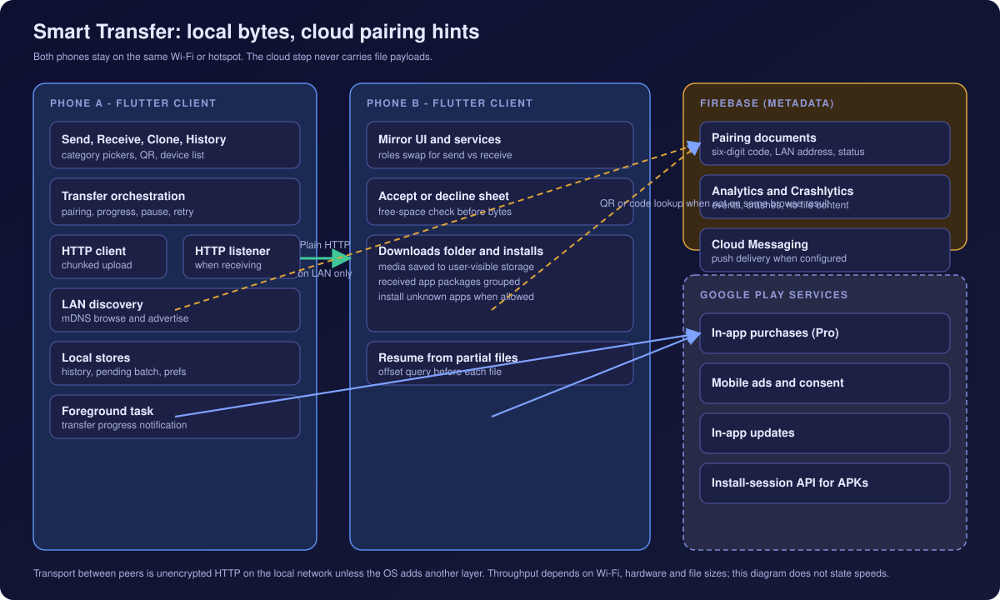
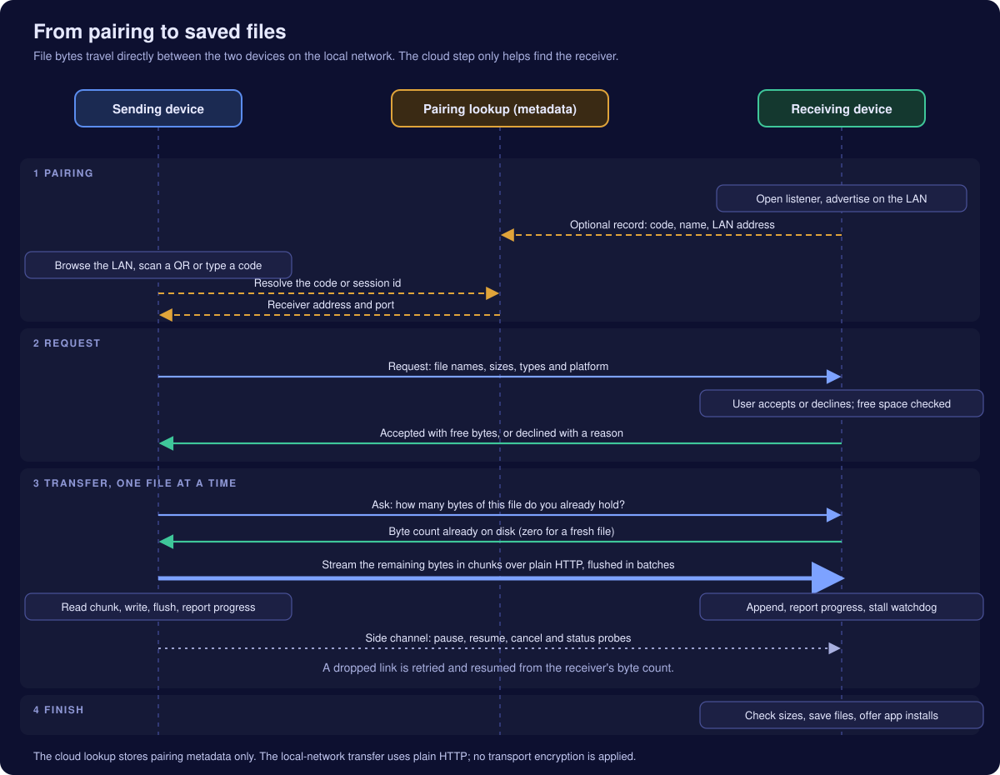
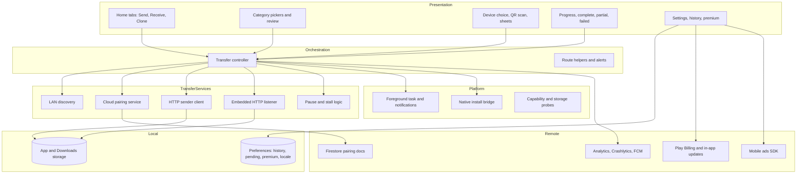
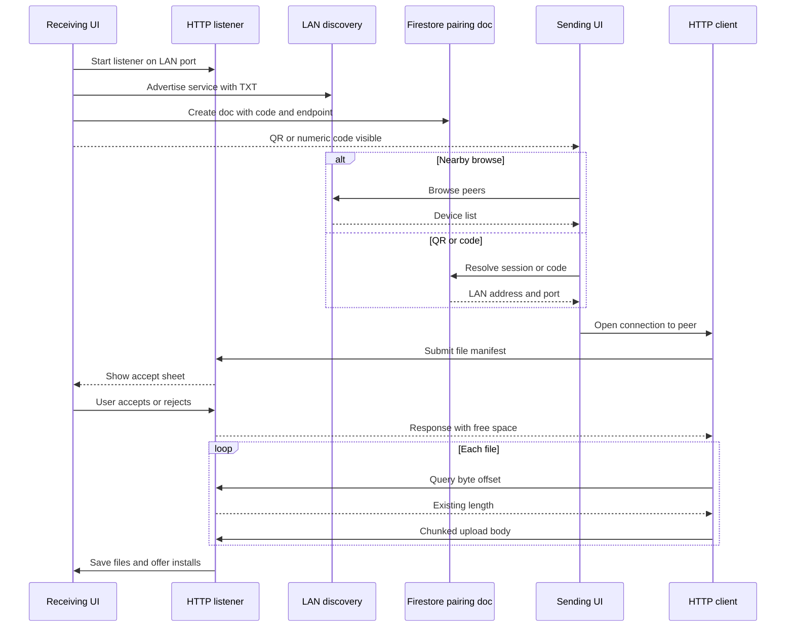

# Architecture

Diagram labels are conceptual and do not correspond to production identifiers.

## System overview

  

Smart Transfer is a single Flutter application targeting Android for release. Nearly all transfer logic executes on the two peer phones. Cloud Firestore participates only in pairing and session state—not in file payload relay. Google Play services supply billing, ads, and in-app updates; Firebase supplies analytics, crash reporting and push delivery.

## Transfer sequence

  

The sequence diagram in the repository README asset folder decomposes pairing, manifest request, per-file offset negotiation, chunked upload, side-channel control messages, and final verification into four phases. File bytes never traverse the cloud box in that figure.

## Layered structure

| Layer | Responsibility |
|---|---|
| **Presentation** | Material screens for each step of send, receive and clone; modal sheets for connect, accept and alerts; widgets for progress rings, device tiles and storage summaries. |
| **Orchestration** | Single long-lived controller per active transfer session wiring streams from discovery, server and client into UI state; handles pairing method analytics and revision bumps when Receive regenerates codes. |
| **Transfer services** | mDNS advertise/browse, Firestore CRUD for sessions, Dart HTTP server on receiver, HTTP client on sender with chunked writes, QR codec, LAN address selection. |
| **Platform bridges** | Kotlin-side helpers for APK install sessions, unknown-app-source checks, and other APIs not exposed cleanly in pure Dart. |
| **Local stores** | Preferences for JSON history lists, pending sender batches, premium boolean, language code; filesystem paths for incoming partial and complete files. |
| **Remote integrations** | Firestore for pairing; Firebase SDKs for telemetry and push; Play Billing and Mobile Ads as separate Google SDK paths. |

## Pairing state flow

## Module boundaries (conceptual)

Feature folders group UI and services:

- **Transfer** — screens, widgets, controller, LAN client/server, discovery, QR codec, cloud session wrapper, gallery and folder pickers, APK encoding, preflight, notifications.
- **History** — models, list/detail screens, preferences-backed service.
- **Permissions** — first-run education screen and shared tile widgets reused from Settings.
- **Settings and premium** — toggles, policy viewer, billing UI.
- **Onboarding and splash** — first-run marketing and animation entry.
- **Core** — theme, routing, analytics wrapper, ads service, premium singleton, locale service.

Shared widgets provide buttons, headers and snack bars consistent across features.

## Data categories and sources

| Category | Source mechanism |
|---|---|
| Photos / videos | Gallery index via photo manager APIs with permission prompts |
| Music | Audio media store scan |
| Documents | System document picker and file paths |
| Apps | Installed package list with size metadata where available |
| Folders | Custom browser with storage access helper for all-files grant |

Each selected item normalises into a transfer file model carrying display name, byte size, mime type and platform-specific source path or content URI.

## Failure and edge routes

Dedicated screens and dialogs cover: pairing timeout, HTTP connection failure, receiver decline including low storage, stalled upload watchdog, LAN disconnect banner, partial completion with retry list, user cancel with QR invalidation messaging, and missing install permission for received APKs.

## What sits outside this app

There is no custom backend service for accounts or file relay in the described architecture. Firestore security rules and Firebase project configuration are not published in this portfolio. Entitlement verification for Pro is not delegated to a server in the release described here.
